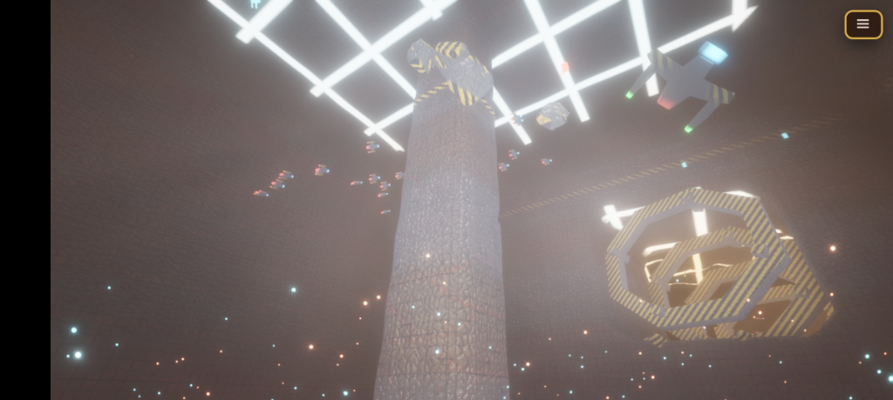
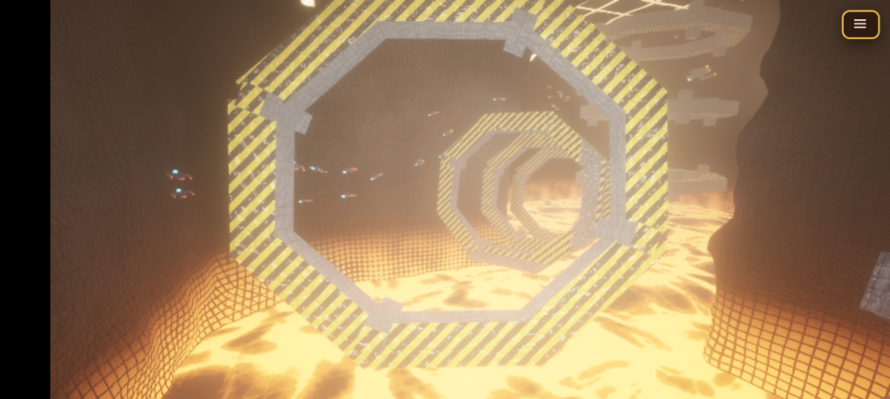

# Abyssal Mine

**A procedural 6DoF subterranean mine you can fly through in your browser — built to test whether the [Abyssal Garden](https://github.com/Noniv/abyssal-garden) WebGPU engine can handle fully enclosed *Descent*-style geometry.**

The free-floating 3D movement and voxel wall-sliding collision in the original *Abyssal Garden* underwater demo felt unmistakably reminiscent of Parallax Software's 1995 6DoF shooter *Descent*. **Abyssal Mine** flips the original open-top seabed inside out—starting from solid asteroid rock and carving out an interconnected network of closed octagonal tunnels, vertical mining shafts, molten magma foundries, and a central Reactor Core, all in **one 84.2 KB self-contained HTML file** with no external textures, models, or audio files.

## Try it

- **Live Demo:** **[https://hoyajavis.github.io/abyssal-mine/](https://hoyajavis.github.io/abyssal-mine/)**
- **Offline:** Download [`index.html`](index.html) and open it in **Chrome** or **Edge** (requires **WebGPU**). Wait a few seconds while the mine is excavated on your GPU, then press **Launch Pyro-GX** to fly.

## Screenshots





## Closed-Geometry & *Descent* Adaptations

- **Inverted 3D Voxel Carving:** Instead of an open seabed with upward mesas, the compute shader (`W_DENS`) initializes the `512 × 112 × 512` voxel grid as solid rock and carves **9 octagonal chambers** connected by **16 3D tunnel segments** (including a vertical mining shaft and diagonal 6DoF bypass chutes), leaving structural shield pillars inside the vaults.
- **Hard-Edged Industrial Architecture:** Surface Nets smoothly meshes the blasted rock walls, while [`Mesh.sweep()`](source/src/math.js) generates crisp, split-normal octagonal steel bulkhead frames placed along every tunnel segment, alongside defense turrets, pipe manifolds, and a central **Reactor Core**.
- **6DoF Flight & Wall-Sliding Collision:** True 6-Degrees-of-Freedom movement with roll (`Q` / `E`), roll-compensated mouse look, vertical/lateral thrusters, and sub-stepped 3D brick-SDF collision (`collide()`) that slides cleanly along tunnel walls, floors, and ceilings.
- **Subterranean Lighting & Materials:** Replaces top-down sunlight with a baked 3D local radiance volume (`tVol`), dual ship headlights with volumetric dust beams, glowing ceiling light strips, 45° yellow-and-black hazard stripes, floor grates, and convecting molten magma lakes (`y = -49.5m`).
- **Autonomous Mining Automatons:** Faceted Class-1 Hulk mechs and Patrol Drone squadrons banking through the chambers, plus a procedural Web Audio reactor thrum, thruster hum, and Phrygian synth soundscape.

## Controls

| Action | Keyboard & Mouse |
|---|---|
| Pitch & Yaw | Move the mouse |
| Thrust / Strafe | `W` `A` `S` `D` (or Arrow keys) |
| Roll Left / Right | `Q` / `E` |
| Slide Up / Down | `R` / `F` (or `Space` / `C`) |
| Afterburner (faster) | Hold `Shift` |
| Jump to a Zone | `1` to `6` (Reactor, Magma Foundry, North Shaft, Processing Bay, Arterial Corridor, Energy Center) |
| Menu | `Esc` |
| Sound on / off | `M` |
| Performance stats | `H` |
| Detail level | **Low**, **Medium**, or **High** in the menu (reloads the page) |

## Detail levels

The **Low**, **Medium**, and **High** buttons in the menu pick the detail level; the current one is lit. Each level is the same mine, built with scaled-down density and shader cost:

| Level | What it is | Picked on a first visit for |
|---|---|---|
| **High** | Full conduit, spark, and rubble density; 4× MSAA; 8× anisotropic filtering; `512×512` magma/plasma texture; 34-step volumetric headlight & reactor beams | Desktop computers |
| **Medium** | Half of the hanging conduits, spark glints, and floor rubble; 4× MSAA; `512×512` magma texture; 34-step volumetric beams | Phones with 8 GB+ of memory |
| **Low** | Quarter of the conduits, sparks, and rubble; no MSAA; coarser rock chunks and turret/crystal LODs; `256×256` magma texture; 12-step volumetric beams; starts at 480p | Other phones, and computers with 4 GB of memory or less |

If loading crashes the tab or the graphics driver resets, the page automatically reloads one level lower. Your browser remembers the chosen level, dynamic resolution, and draw distance scale (`localStorage.abyssalMine`) between visits.

## Build & Verify

The readable source code lives in [`source/`](source). To test, modify, and rebuild `index.html` (requires [Node.js](https://nodejs.org) 18+):

```bash
cd source
npm install
npm test           # runs 3D traversability, flood-fill connectivity, fly-through & mesh tests
npm run build      # writes minified ../index.html
```

- `npm run build:readable` writes an unminified `index.html` for easier debugging.
- `npm run build:dev` writes `dev.html` with `F` (60-second scripted fly-through) and `B` (benchmark mode reporting frame and GPU times).

| File | What's inside |
|---|---|
| [`source/src/world.js`](source/src/world.js) | Mine chambers, 3D tunnel graph, shield pillars, bulkhead placement, Reactor Core, turrets, and patrol robots |
| [`source/src/shaders.js`](source/src/shaders.js) | `W_DENS` tunnel carving SDF, triplanar rock/steel/hazard-stripe shading, molten magma, headlights, and volumetric beams (WGSL) |
| [`source/src/main.js`](source/src/main.js) | WebGPU renderer, 6DoF flight physics, brick-SDF `collide()`, 6 zone viewpoints, and 60s fly-through spline |
| [`source/src/math.js`](source/src/math.js) | Voxel grid config, Naive Surface Nets, noise, quaternion helpers, and `Mesh` sweep/tube builders |
| [`source/src/audio.js`](source/src/audio.js) | Procedural Web Audio reactor drone, thruster hum, plasma arcs, and patrol telemetry |
| [`source/src/quality.js`](source/src/quality.js) | Detail presets (Low / Medium / High) and crash-recovery fallback |
| [`source/test.mjs`](source/test.mjs) | Automated traversability, 3D flood-fill connectivity, wall-sliding collision, and shader/mesh integrity tests |
| [`source/template.html`](source/template.html) | Page shell, loading bar, menu UI, and control legend |

## License

[MIT](LICENSE) — free to use, change, and share. Based on [Abyssal Garden](https://github.com/Noniv/abyssal-garden).
